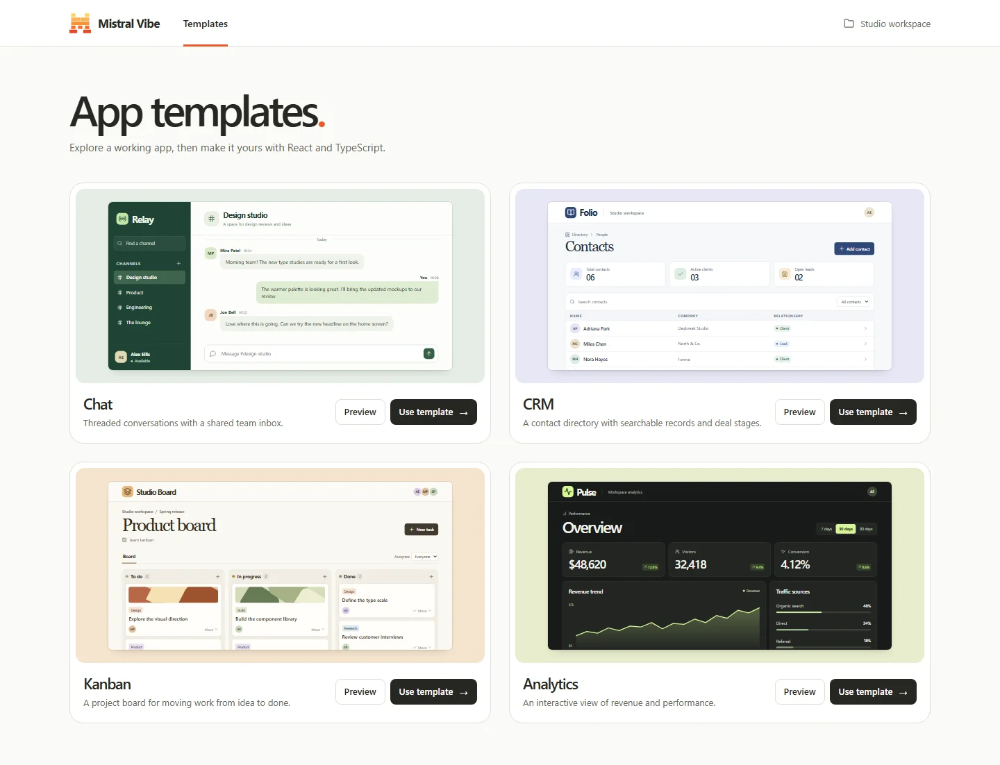

# App templates

Type `/templates` in a session of this fork. Vibe opens the local gallery for the current workspace and prints a link you can open manually. Keep the session running while you browse.



Select **Preview** to try an app. Select **Use template**, enter a new folder name, and check the destination. **Create project** writes editable React components, TypeScript, CSS, sample data, and a locked npm dependency list into that folder. The confirmation gives you the commands to run it.

## Run the fork from source

Install Git, uv, and the Rust toolchain for your platform, then run:

```sh
git clone https://github.com/angelovydn/mistral-vibe.git
cd mistral-vibe
uv run vibe
```

To work in a different directory, start Vibe from that directory with `uv run --project "/path/to/mistral-vibe" vibe`. The first launch builds the terminal client. Complete Vibe’s usual sign-in, then enter `/templates`.

The bundled previews work immediately. To develop a generated app, use Node.js 22.12 or newer and run the commands shown in the gallery. For a project named `my-chat`, they are:

```sh
cd "my-chat"
npm ci
npm run dev
```
